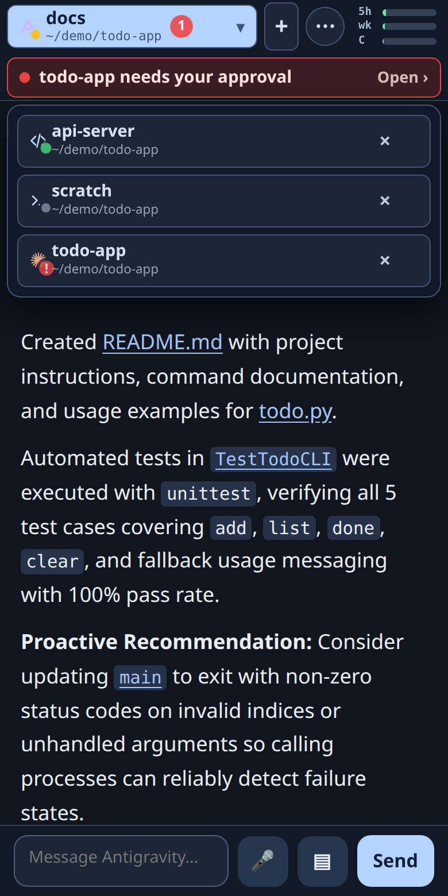
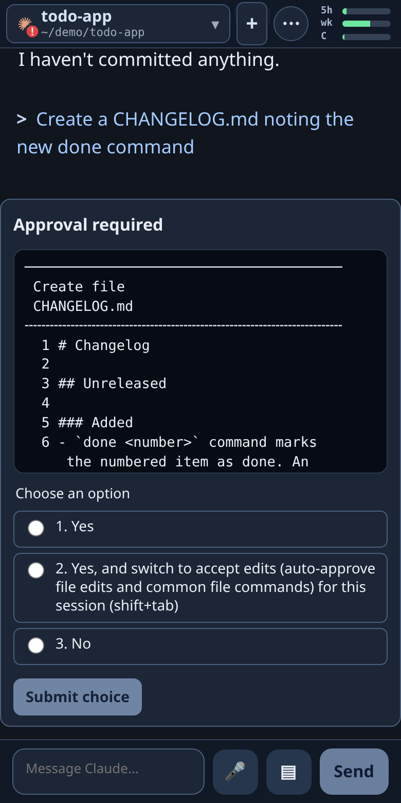
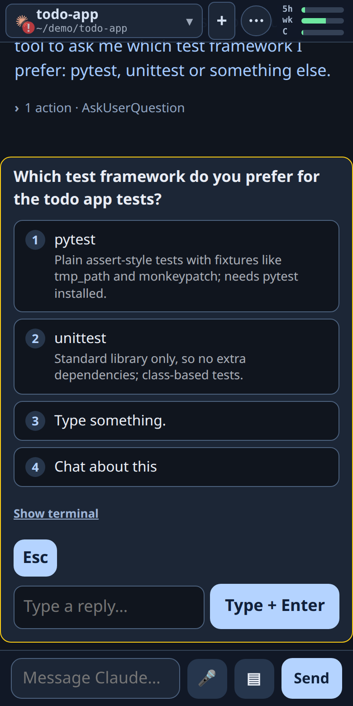
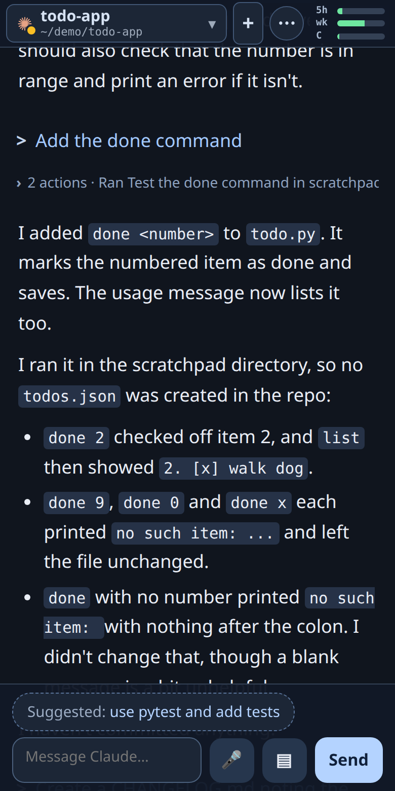
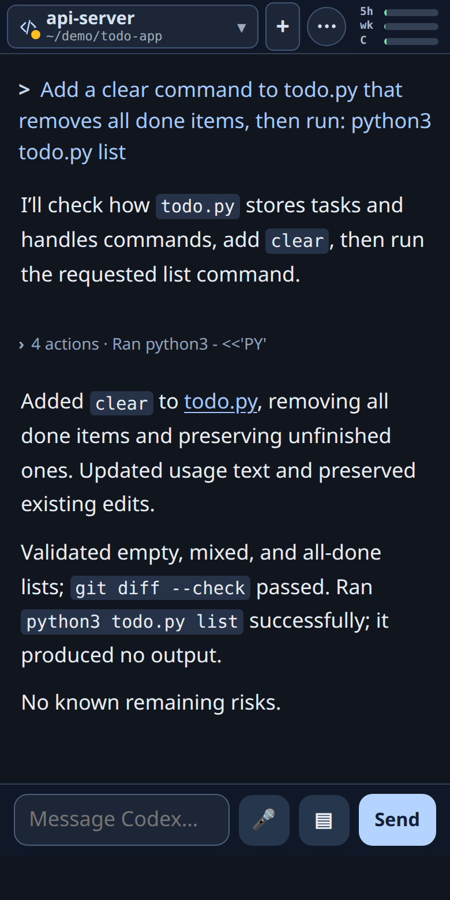
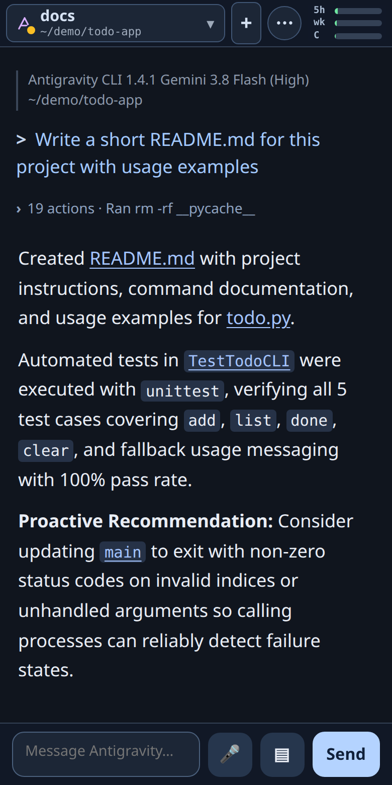
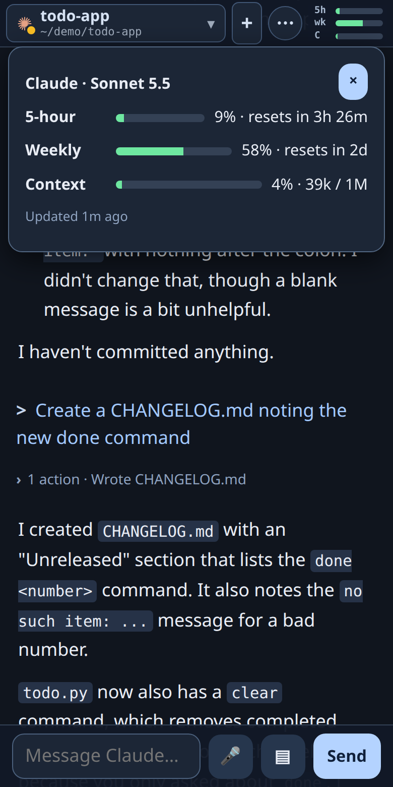
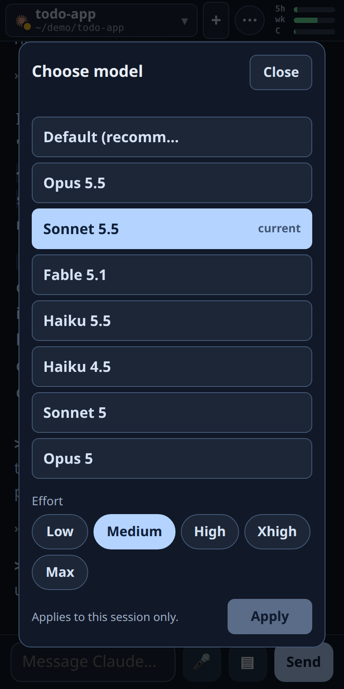
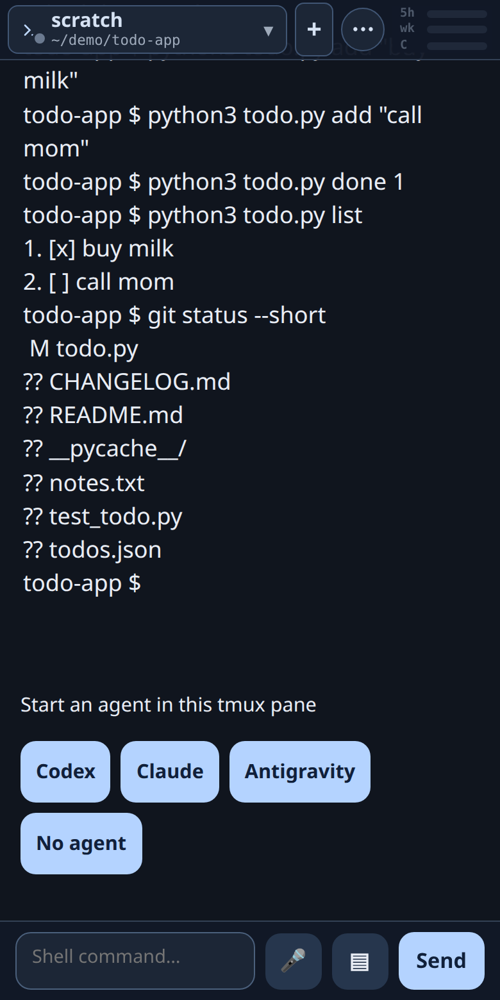

# Mobile Tmux

[](https://github.com/LowellWinston/mobile_tmux_public/actions/workflows/test.yml)
[](LICENSE)

**Keep working with your coding agent when you're away from your desk.**

Start [Claude Code](https://claude.com/claude-code), [Codex CLI](https://github.com/openai/codex) or Antigravity (`agy`) on your own machine, then carry on from your phone. Read what the agent has done, approve its requests, answer its questions and send the next instruction, from the sofa, the train or a long queue. The agent keeps running in tmux on your computer, so nothing stops when you walk away.

- **Approve without going back.** A long run stops to ask permission. You get the real request as buttons and tap one.
- **Chat, not a terminal.** The conversation reads like a chat, with tool actions collapsed, instead of a phone-sized terminal.
- **All your agents in one place.** Switch between sessions as tabs, see which one is waiting for you, and get a push notification when one needs you.
- **Your machine, your data.** It runs on your computer. Nothing goes through anyone else's server, and there is no account.

This is a phone front end for the tmux sessions that run your agents and shells: type `!command` to run a shell command in a session's folder, or open a plain shell tab with no agent. It is not a general tmux client: it has no windows, splits or layouts, and does not plan to.

## Screenshots

<table>
  <tr>
    <td align="center"><br><sub>Every agent at a glance, with an alert when one needs you</sub></td>
    <td align="center"><br><sub>Approvals show the real request and options</sub></td>
    <td align="center"><br><sub>Multiple-choice questions become a card</sub></td>
  </tr>
  <tr>
    <td align="center"><br><sub>Claude Code</sub></td>
    <td align="center"><br><sub>Codex CLI</sub></td>
    <td align="center"><br><sub>Antigravity</sub></td>
  </tr>
  <tr>
    <td align="center"><br><sub>5-hour, weekly and context usage</sub></td>
    <td align="center"><br><sub>Model and effort picker</sub></td>
    <td align="center"><br><sub>Shell commands, with the folder following your <code>cd</code></sub></td>
  </tr>
</table>

First run: each agent asks to trust the folder, and the page shows that prompt as buttons too ([screenshot](docs/screenshots/10-first-run.png)).

## Features

- **Reads the agent's own history, not the screen.** The chat is rebuilt from each agent's transcript files, so it is clean text, not a terminal scrape. The one exception is a pending approval or question: it is not in the history yet, so the prompt is read from the pane.
  Input goes into the pane through tmux, exactly as if you had typed it.
- **Approvals and questions as buttons.** Folder-trust prompts, permission requests and multiple-choice questions show up with their real options.
- **Usage at a glance.** Rings for the 5-hour allowance, weekly allowance and context use, from each agent's official reports.
- **Photos and files.** Tap the + button next to the message box, then "Photo or file", to attach a screenshot, a photo or any file (up to 20 MB). It is saved on your machine and its path goes into your message, so Claude, Codex and Antigravity can all open it. On a computer you can also paste a screenshot (Ctrl/Cmd+V) or drop files onto the page. Photos are shrunk and their location data removed before they leave the phone.
- **Model and effort pickers**, `/slash` commands, `!shell` commands in the session's folder, dictation, and push notifications when an agent needs you.
- **Several sessions as tabs**, with the working folder, an Idle/Working/Approval state, and a start button for each agent.
- **No dependencies, no build step.** A single Python standard-library server and one web page.

## Requirements

- Linux (it relies on `/proc` and the agents' file layouts on Linux). macOS is not supported yet.
- Python 3 (developed and tested on 3.14; older versions are untested) and `tmux`.
- At least one agent installed and run **inside tmux**: Claude Code, Codex CLI, or Antigravity.
- Optional: [`ttyd`](https://github.com/tsl0922/ttyd) for the full interactive terminal ("Interact"); `pywebpush` for push notifications (`pip install pywebpush`).

## Quick start

```bash
git clone https://github.com/LowellWinston/mobile_tmux.git
cd mobile_tmux
python3 deploy/install.py --hooks     # systemd user service, plus the usage-ring hooks
```

The installer needs no root. It prints the address and your **access token**. Then, on the same machine:

1. Start an agent in tmux: `tmux new -s work`, then `claude` (or `codex`, or `agy`).
2. Open `http://127.0.0.1:7683/mobile/` and sign in with the token.

To try it without installing a service: `python3 server.py`.

### Reaching it from your phone

By default the server listens on `127.0.0.1` only. Anyone who can reach it can type into your agents and run commands as you, so **do not
expose it to the internet directly**. Good ways to reach it:

- **Tailscale (simplest).** Install Tailscale on the machine and the phone, then `tailscale serve --bg --https=443 http://127.0.0.1:7683`.
  Open `https://<machine>.<tailnet>.ts.net/mobile/`. You get HTTPS (needed for push notifications and installing it as an app), and only your devices can reach it.
- **Your own HTTPS reverse proxy** with its own sign-in. Set `MOBILE_TMUX_AUTH=proxy` (see below) and use
  [`deploy/examples/nginx-auth-proxy.conf`](deploy/examples/nginx-auth-proxy.conf) as a starting point.
- **Plain LAN over HTTP.** Set `MOBILE_TMUX_HOST=0.0.0.0` and sign in with the token. The token and chat then cross your network unencrypted,
  so only do this on a network you trust. Push notifications and "add to home screen" need HTTPS.

On the phone, open the page and use "Add to Home Screen" for an app-like view.

## Signing in and security

| Mode | Set with | Behavior |
| --- | --- | --- |
| `token` (default) | nothing | One access token, created on first run in `~/.config/mobile-tmux/token` (owner-only). Signing in sets an HttpOnly, SameSite=Strict cookie. Failed attempts are rate-limited. |
| `proxy` | `MOBILE_TMUX_AUTH=proxy` | A reverse proxy in front signs people in; the server trusts it. It refuses to start unless it is bound to loopback, so nothing can reach it around the proxy. |

State-changing requests also need a matching `Origin` and a custom header, so another website cannot drive it from your browser.
To rotate the token, delete `~/.config/mobile-tmux/token` and restart the service.

Be clear about what this tool is: a remote control for programs that can edit files and run commands as your user. Treat the access token like an SSH key.
The `!command` feature runs shell commands as the user the server runs as. Report security problems privately (see [SECURITY.md](SECURITY.md)).
Attachments are written to `~/.cache/mobile-tmux/uploads/` (owner-only, random name prefix) and deleted after a week. They are never served back over HTTP. The agent may ask your permission to read that folder, because it is outside your project; allow it for the session and later attachments need no further prompt.

## Usage rings (the `--hooks` step)

Claude Code and Antigravity report usage through a "status line" command. `deploy/install.py --hooks` points that at small recorders
(`claude_usage.py`, `antigravity_status.py`) that save the report for the page. It never replaces a status line you already have; in that case
add the command yourself, for example in `~/.claude/settings.json`:

```json
{"statusLine": {"type": "command", "command": "/usr/bin/python3 /path/to/mobile_tmux/claude_usage.py"}}
```

For Antigravity the same block goes in `~/.gemini/antigravity-cli/settings.json` with `antigravity_status.py` and `"enabled": true`.
Restart the agent after changing this. Codex needs no hook. Without the hooks everything else works; the rings just show "n/a".

## Configuration

All optional, set as environment variables (for the systemd service, add `Environment=NAME=value` to the unit and restart).

| Variable | Default | Meaning |
| --- | --- | --- |
| `MOBILE_TMUX_HOST` | `127.0.0.1` | Address to listen on. |
| `MOBILE_TMUX_PORT` | `7683` | Port to listen on. |
| `MOBILE_TMUX_AUTH` | `token` | `token` or `proxy` (see above). |
| `MOBILE_TMUX_TTYD_PORT` | `7682` | Where the optional ttyd runs. |
| `MOBILE_TMUX_PUSH_SUBJECT` | `mailto:mobile-tmux@localhost` | Contact (a `mailto:` or `https:` URL) sent to push services. Set your own email if you use push. |
| `MOBILE_TMUX_HOME` | your home | Where agent folders (`~/.claude`, `~/.codex`, `~/.gemini`) are looked up. |
| `MOBILE_TMUX_CACHE` | `~/.cache/mobile-tmux` | Working data (usage reports, saved notices). |
| `MOBILE_TMUX_CONFIG` | `~/.config/mobile-tmux` | The access token and push keys. |
| `MOBILE_TMUX_TMUX` | found on `PATH` | Path to the `tmux` binary. |

## How it works, and its limits

Details are in [docs/behavior.md](docs/behavior.md). In short: the server finds your tmux panes every few seconds and maps each one to a live agent
conversation, then serves the chat to the page. Before it types anything it checks that the pane still runs the same agent process and
conversation, and that the input box is empty, so it never overwrites something you were typing. Still:

- Use one input surface at a time. If you type in the terminal and on the phone at once, they can race.
- Agents change their output formats. Parsing of approval prompts, pickers and status lines is per-agent and can break after an agent update; please file an issue with the agent and version.
- Two Codex sessions in the same folder cannot be told apart, so the second one is read-only.
- Tool output and the agent's reasoning are deliberately left out of the chat.

## Questions, ideas and bugs

Questions, setup help and ideas belong in [Discussions](https://github.com/LowellWinston/mobile_tmux_public/discussions).
Bugs go in [Issues](https://github.com/LowellWinston/mobile_tmux_public/issues); please include the agent and its version, and for prompt or
status-line problems the text of the pane (`tmux capture-pane -p -t <pane>`) with anything private trimmed.

## Development

```bash
python3 -m unittest test_session_controls test_agent_notices test_auth test_uploads    # or: pytest
```

The tests use fixtures and mocks and need no running tmux or agents. See [CONTRIBUTING.md](CONTRIBUTING.md). Licensed under the [MIT License](LICENSE).
